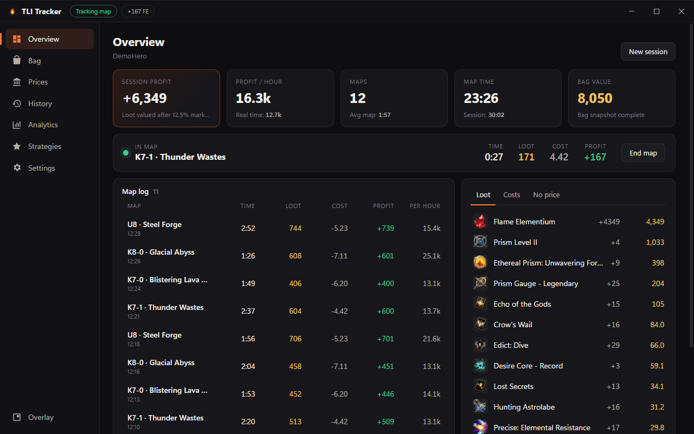
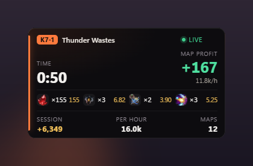
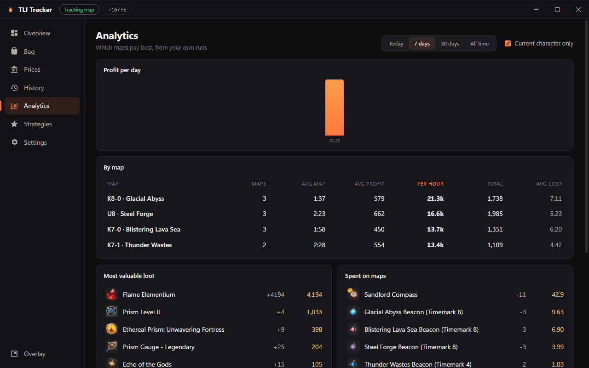
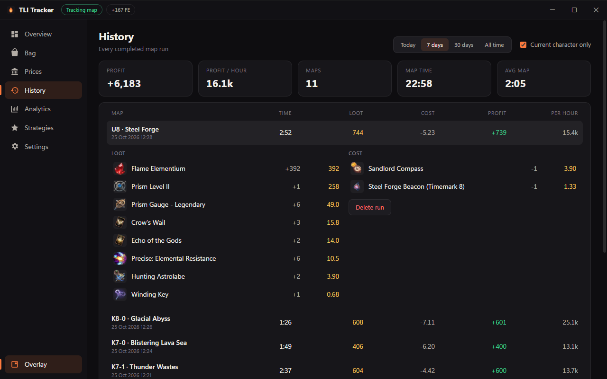
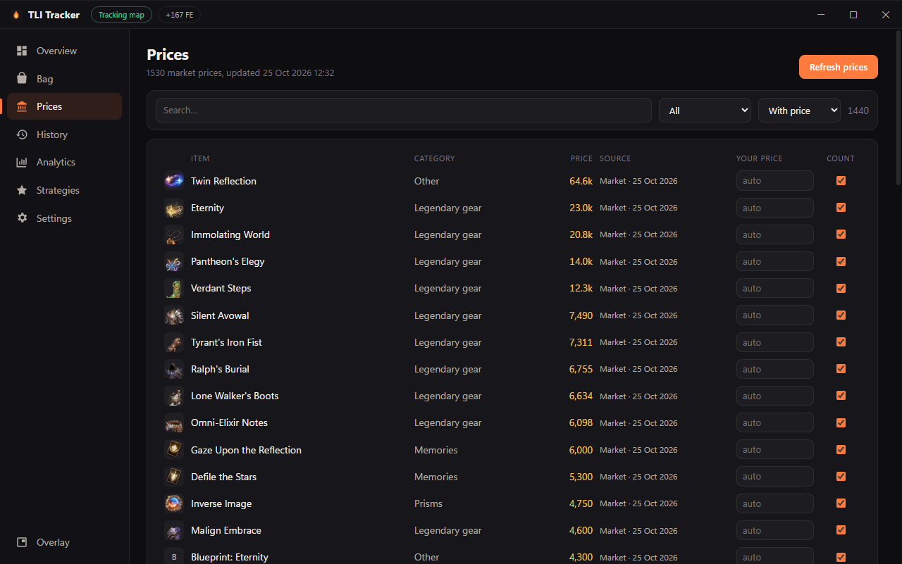
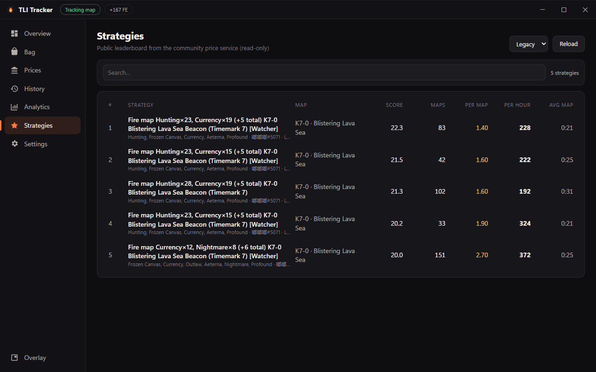
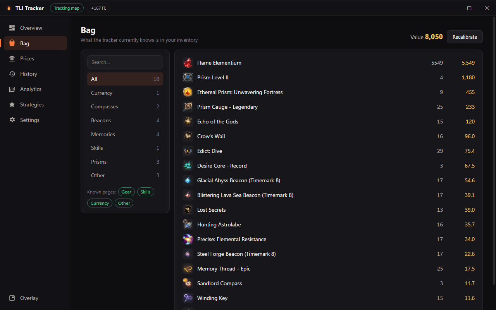
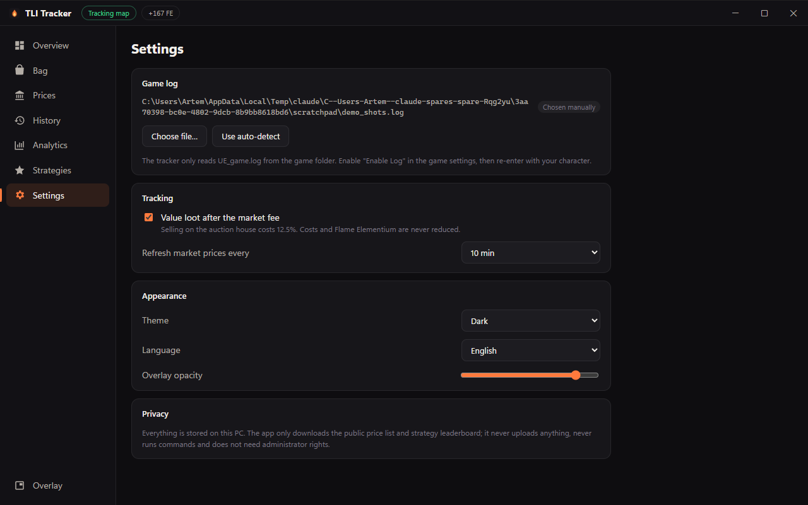

# TLI Tracker

A free, open-source loot and profit tracker for **Torchlight: Infinite** on
Windows. It reads the game's own log file, works out what every map run
dropped and cost, values it with community market prices and shows profit per
map, per hour and per session.

## Why another tracker?

ETor (易火) is a great tool, but it's built as a thin window around the
developer's website: the interface is loaded from their server on every
start, that page can run Windows commands through the app, and the app asks
for administrator rights.
In practice that means it fully trusts that server. If you're fine with that
trade-off, it works great.

TLI Tracker takes the opposite approach: the whole interface ships inside the
app, there is no way for a server to run anything on your PC, and it needs no
admin rights. [Security and privacy](#security-and-privacy) lists the
differences, with file names and lines so you can check them yourself.

Prices and the strategy leaderboard come from ETor's public price service
(read-only, nothing is sent back), so thanks to its authors for running it.

## At a glance

- **Desktop app** for Windows 10/11: Tauri 2 (Rust) + Angular 22. One small
  `.exe`, no Node or Rust needed to run it.
- **Local first**: all data lives in `%APPDATA%\local.tlitracker.app\`.
- **English UI**, with translations as plain JSON files (see
  [Adding a language](#adding-a-language)).



## Features

| Page | What it shows |
|---|---|
| Overview | Session profit, profit/hour (map time and real time), map count, live timer for the current map, map log, session loot and costs |
| Bag | Everything the tracker knows is in your inventory, by category, with value |
| Prices | ~1 500 market prices, your own auction-search prices, manual overrides, "count in profit" switch per item |
| History | Every finished run, filterable by day range and character, with per-run drops |
| Analytics | Your own runs grouped by map (timemark × region): avg time, avg profit, profit/hour, daily profit, top loot, map costs |
| Strategies | The community strategy leaderboard (read-only), translated from Chinese |
| Overlay | Small always-on-top window with the current map timer and profit |

<p align="center"></p>

| | |
|---|---|
|  |  |
|  |  |
|  |  |

Screenshots use the synthetic session from `scripts/demo_log.py --instant`.

## Getting started

1. Download `TLI Tracker_x.y.z_x64-setup.exe` from
   [Releases](https://github.com/ArtemNA/tli-tracker/releases) and run it.
   It installs for the current user; no administrator rights are needed.
2. In Torchlight: Infinite open **Settings** and turn on **Enable Log**
   (not "Upload Log").
3. Go back to character selection and enter the game again.
4. Open the **Currency** and **Other** tabs of your bag once (or sort them).
   This gives the tracker an exact starting count, so every pickup is measured
   precisely.
5. Play. Runs appear in the map log as you go from map to map.

The game log is found automatically in Steam libraries
(`…\Torchlight Infinite\UE_game\TorchLight\Saved\Logs\UE_game.log`). For other
installs pick the file in **Settings → Game log**.

## How tracking works

The game writes network messages and inventory changes to `UE_game.log` when
logging is enabled. The tracker tails that file (read-only) and:

- **Loot** is measured as the change of each bag stack. Every stack has a
  unique id and the log reports its new total, so a pickup is counted exactly
  once no matter how many messages mention it. Until a bag page has been seen
  in full, only stacks that were already observed are counted.
- **A map run** starts when you enter a new area that is not a town or
  hideout, and ends when the next one starts. Time in town pauses the run;
  returning to the same map through the portal continues it.
- **Map cost** is what the map device consumed (beacons, compasses, …) right
  before you entered.
- **Value**: Flame Elementium counts as 1. Other items use, in order: your
  manual price, then whichever is newer of your own in-game auction search or
  the public market price. Loot is reduced by the 12.5% auction fee unless you
  turn that off; costs never are. Organs are never priced.

The Rust side lives in `src-tauri/src/`:

| File | Role |
|---|---|
| `parser.rs` | Turns log lines into events (pickups, map entry, costs, page resets, auction searches) |
| `tracker.rs` | Bag snapshot, map runs, sessions |
| `prices.rs` | Price table and valuation |
| `strategy.rs` | Strategy leaderboard parsing |
| `net.rs` | The only network code (read-only GETs, validation helpers) |
| `views.rs` | What the UI receives |
| `lib.rs` | Log discovery and tailing, persistence, commands, overlay window |

## Security and privacy

A static review (no code was run) of ETor 1.3.0, the English translated
build, found the following. Everything except the auto-updater is also in the
original Chinese build shipped inside it:

| ETor | TLI Tracker |
|---|---|
| The UI is loaded live from the author's website on every start | The UI is bundled in the exe; CSP `script-src 'self'` |
| That website gets `runShellCommand`, which runs **any** command via `child_process.exec` with no filtering | No shell access at all: no shell plugin, no command execution anywhere |
| Requires administrator rights (`requireAdministrator`) | Runs as a normal user |
| Chromium sandbox disabled (`no-sandbox`) | Default WebView2 sandbox |
| `save-to-temp` writes any path the page names; `open-window` gives any URL the same privileged bridge | Not present. The web layer can only move/minimize/close its own window |
| Auto-update (added by the English translation) downloads and installs a zip without any signature check | No auto-update |
| Uploads your prices and reports, signed with a key embedded in the app | Uploads nothing |

### How to verify

You don't need reverse-engineering tools; an Electron app's code is plain
JavaScript inside an archive.

- **Admin rights**: Windows shows a UAC prompt when ETor starts.
- **Remote UI**: open `https://etor-beta.710421059.xyz` in any browser; it is
  the same interface the app shows.
- **Shell access**: unpack the archive (needs Node.js; or use 7-Zip with an
  Asar plugin):

  ```bash
  npx @electron/asar extract "resources/app.asar" etor-src
  ```

  In the translated 1.3.0 build, `etor-src/build/obf-app/main.js` loads the
  site at line 87, registers `run-shell-command` at line 941 and passes the
  received string to `exec(command, …)` at line 950. `build/obf-app/preload.js`
  exposes it to the page as `runShellCommand`. The original build's
  `build/obf-app/main.js` is obfuscated, but its `preload.js` exposes the same
  `runShellCommand`, and the readable source `main.js` in the same archive has
  the same `exec` handler.
- **Auto-update**: `build/obf-app/updater.js` (translated build).

What the app does over the network:

- `GET https://etor-beta.710421059.xyz/etor-api/api/player/season-status`
- `GET …/api/prices-snapshot/{season}`
- `GET …/api/strategy/stage-options` and `…/api/strategy/leaderboard` (only
  when you open Strategies)

These are public, read-only endpoints of ETor's community price service. The
host is hard-coded, HTTPS only, redirects are refused, bodies are capped at
4 MB and must be JSON. Rust reduces every response to digits-only ids,
bounded numbers and short sanitized strings before the UI sees it, and the UI
only renders them as text. No cookies, ids or game data are ever sent.

The web layer gets no file system, shell, HTTP or updater permissions
(`src-tauri/capabilities/default.json`). Reading the log, saving data and
networking happen in Rust commands with validated arguments.

Item icons ship with the app; nothing is loaded from a CDN at runtime.

## Building from source

Requirements: Node 20+, Rust stable (MSVC toolchain), Python 3 with Pillow
(only for the asset scripts).

```bash
npm install
python -I scripts/build_items.py
python -I scripts/fetch_icons.py
npx tauri build
```

The installer ends up in `src-tauri/target/release/bundle/nsis/`.

For development:

```bash
npx tauri dev
```

Run the Rust tests:

```bash
cargo test --manifest-path src-tauri/Cargo.toml
```

### Trying it without the game

`scripts/demo_log.py` writes a realistic log with a few map runs in real time:

```bash
python -I scripts/demo_log.py demo.log --maps 4 --speed 6
```

Point the app at `demo.log` in **Settings → Game log → Choose file**.

### Checking a real log

To see what the tracker recognises in a game log (pickups, map entries,
costs, runs), play it through the parser offline:

```bash
cargo run --manifest-path src-tauri/Cargo.toml --example replay -- path/to/UE_game.log --events
```

## Adding a language

All UI text is in `public/locales/en.json`. To add a language:

1. Copy `en.json` to e.g. `public/locales/uk.json` and translate the values.
   Missing keys fall back to English.
2. Add it to `public/locales/languages.json`:
   `{ "code": "uk", "name": "Українська" }`.
3. Pick it in **Settings → Appearance → Language**.

The `terms` section translates the Chinese words used in community strategy
names; item names in them are translated automatically from the item list.

## Data and credits

- `src/data/items.json` is generated by `scripts/build_items.py` from:
  - English item names from
    [sattatracker-TLI-Tauri](https://github.com/sattatrapy/sattatracker-TLI-Tauri-public)
    (MIT, see `data-src/sattatracker_LICENSE.txt`);
  - item ids, categories and icon references from ETor's public game data,
    with English names from [tlidb.com](https://tlidb.com) links as fallback.
- Item icons are downloaded from the tlidb.com CDN by
  `scripts/fetch_icons.py` and are not part of this repository.
- Prices and strategies come from the public ETor price service.
- The log format and the market-price heuristic were learned by studying
  ETor's tracker; credit to its authors for that research. No ETor code is
  included.

Torchlight: Infinite is a trademark of XD Inc. This project is not affiliated
with XD Inc., ETor or tlidb.

## License

[MIT](LICENSE)
